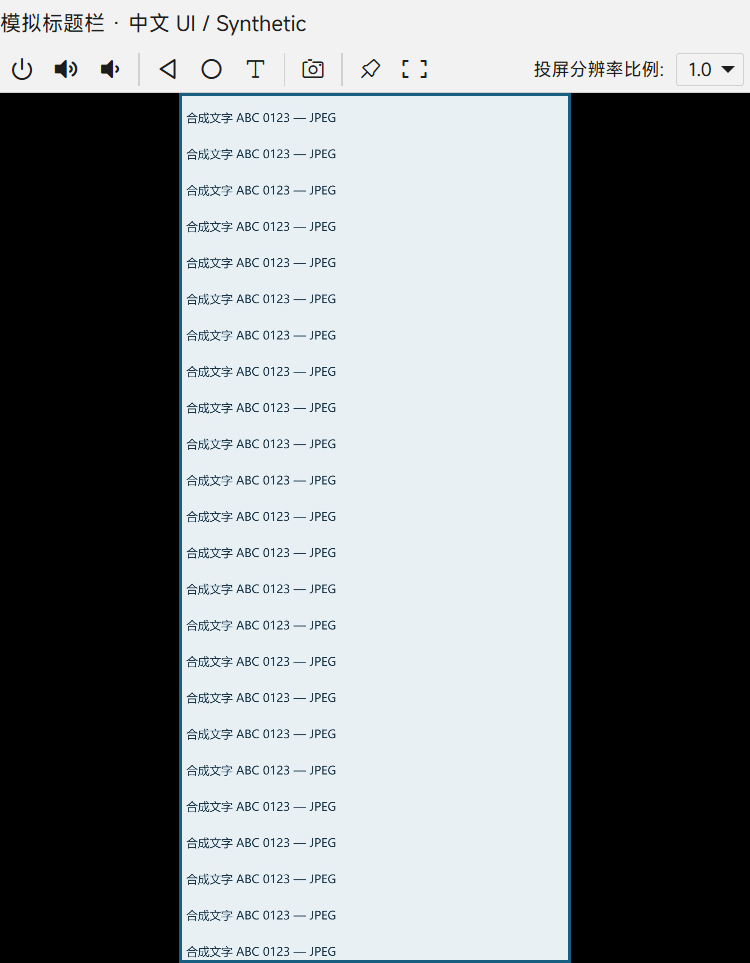
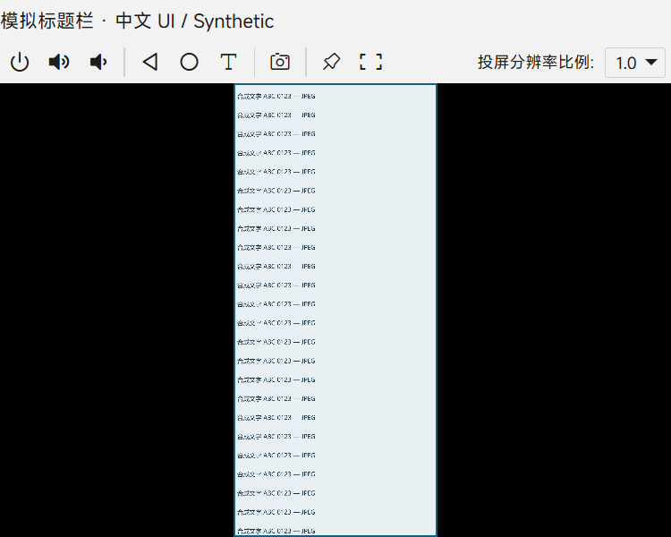
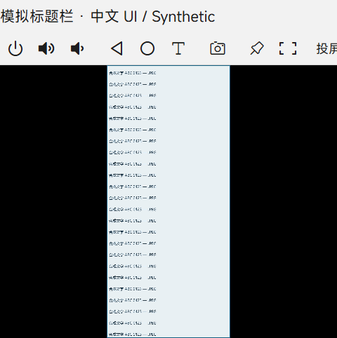
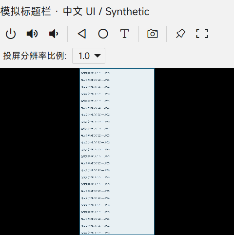
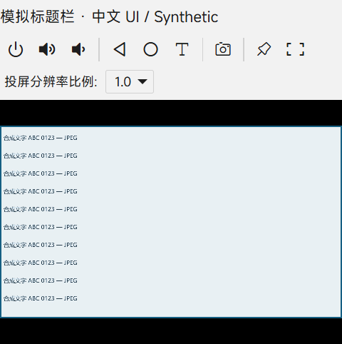

# M3-1 / M3-2 显示验证

2026-10-22（Asia/Hong_Kong），Codex；基线 `9e944ae27ad7cc4c656467257e3e84d8067dc2f8`，独立工作树分支 `codex/m3-display`。

**M3-1：待验收。** 已复现并修正固定最小窗口高于小工作区的问题，完成合成 Electron 回归；原报告环境和真实显示器/设备验收未执行。

**M3-2：进行中。** 已完成来源与缩放链分析、同条件合成截图；没有足够证据定位原报告的中文锯齿根因，未更改字体或抗锯齿策略。

## 来源和范围

- [上游 #28](https://github.com/liriliri/echo/issues/28) 正文报告小分辨率电脑上最小窗口仍有很大黑边。2026-10-22 读取正文及评论：无评论，无具体桌面分辨率、DPI、机型或截图。
- [上游 #32](https://github.com/liriliri/echo/issues/32) 只有中文字体锯齿及手机息屏的标题，无正文、评论或附件。无法从原报告区分 UI 文字与投屏文字；息屏属于 M4-4，不在本次实现范围。
- 核对窗口 `src/main/window/screencast.ts`、共享窗口工厂、投屏组件/SCSS、全局字体规则、`ScreencastClient` JPEG 解码和触摸映射。生产改动仅窗口文件及两个组件样式；不修改客户端生命周期、图像加载工具、原坐标测试或子模块。
- 未连接/操作真机、枚举应用、下载 HAP、启动或停止 HDC，也未改变 Windows 分辨率/DPI。共享主目录及其三处既有未提交修改未动。

## 复现、根因和修正

原窗口固定最小值 500×640 DIP。800×600 工作区在 100% 时已经容不下 640 DIP 高度；125% / 150% 时可用 DIP 更少。基线的 48 个样本中，40 个尺寸超出模拟工作区。另有正常保比例的黑边：画布的固有比例和窗口剩余空间不同，保留黑边本身不是缺陷。

修正后最小值为 320×320 DIP；在共享工厂恢复保存位置之后，读取目标显示器 `workArea`，限制窗口宽高和位置，并在显示前应用。已有合法位置保留。小于 320 DIP 的工作区会进一步限制原生窗口最小值，但本轮**不保证小于 320 DIP 的工具栏完整布局**：按钮组可能需要第三行，属于未覆盖的极窄条件。

只降低最小宽度的中间版本复现 24 个窄窗口工具栏裁切样本。最终在 viewport ≤480 CSS px 时固定两行工具栏，将分辨率标签/选择框放到第二行，画面起点同步从 31 改为 62px。大窗口保持一行。没有拉伸画布或裁切帧来消除黑边。

新增 Node 单测先在原实现上出现 3 个预期失败，再全部通过：小工作区初始边界及紧凑最小尺寸、负原点显示器恢复超大窗口、保留有效位置及限制更小工作区。它验证真实 `showWin()` 的窗口策略；Electron 和共享工厂边界由替身提供。实际共享工厂另由下述 Electron fixture 覆盖。

## Electron 验证及可重复步骤

环境：Windows 11 Pro，Node 22.21.1 / npm 10.9.4，锁定 Electron 45.0.0 / Chromium 156.0.8078.48，Playwright 1.64.1。依赖和输出均在独立工作树；没有共享可写 node_modules/dist/release。

```powershell
git submodule update --init --recursive
npm ci
node node_modules/electron/install.js
node script/check-display.mjs dist/display-evidence
node --test test/screencast-layout.test.cjs test/screencast.test.cjs
npm test
npm run lint
npm run build:main
npm run build:renderer
```

脚本每组启动独立 Electron 子进程和临时 userData，退出后清理自己创建的配置。真实运行 BrowserWindow、共享窗口工厂、投屏 `showWin()`、React/Luna 组件、项目样式、客户端 JPEG 解码/Canvas 和坐标计算。替换持久化数据及设备 transport，使用合成尺寸和 JPEG（含重复中文/英文文本及边框）；设备边界没有连接真实 HDC 的路径。

**模拟边界：** `screen.workArea` 注入；只在子进程使用 `force-device-scale-factor`。标题栏用 31px 合成 HTML 占位，没有测试真实自绘标题栏按钮或菜单。运行时显示器读数是在强制缩放后、workArea 注入前取得，不能据此描述物理显示器 DPI。截图是实际 Electron webContents，窗口 bounds 是实际 BrowserWindow 返回值；这不是修改用户桌面分辨率后的验收。

800×600 / 1024×768 是合成可用工作区的物理像素预算，不含额外任务栏预留。除以 1 / 1.25 / 1.5 得到模拟 DIP 工作区。每组覆盖默认窗口、请求 320×320 最小窗口、480×360 / 481×360 断点两侧；合成设备 1080×2400 竖屏和 1920×1080 横屏，JPEG 尺寸为设备尺寸的 1 / 0.5。共 96 样本；另加一组在 800×600/150% 下从负坐标、1200×900 保存窗口恢复的 4 样本，**总计 100 样本通过**。

| 像素预算 / 缩放 | 工作区 DIP | 实测默认窗口 DIP | 实测最小窗口 DIP |
| --- | --- | --- | --- |
| 800×600 / 100% | 800×600 | 500×600 | 320×320 |
| 800×600 / 125% | 640×480 | 504×481 | 323×321 |
| 800×600 / 150% | 533×400 | 500×401 | 320×321 |
| 1024×768 / 100% | 1024×768 | 500×640 | 320×320 |
| 1024×768 / 125% | 819×614 | 505×615 | 322×321 |
| 1024×768 / 150% | 682×512 | 501×513 | 321×321 |

强制 Chromium 缩放与 Windows 原生窗口取整会使请求尺寸和实测不同。完整矩形断言允许工作区各边最多 2 DIP 误差，原始值全部保存；不将 481 DIP 称为严格小于 480 DIP。480/481 是请求值，实际 viewport 和媒体规则结果以报告为准，100% 样本覆盖精确阈值。

最终断言包括：窗口位置/尺寸处于工作区（上述容差）；Canvas 不被工具栏遮挡、不越出 viewport；帧比例误差小于 0.01；恰好 10 个按钮/选择框均有可见尺寸且在工具栏内；真实客户端收到四角/中心共 5 个双坐标，有限数值且距预期设备坐标不超过 1px。合成 PointerEvent 验证映射，不等于真机点击/拖动验收。

## 截图、原始证据与字体分析

阶段报告和选定截图位于 [evidence/M3-display](evidence/M3-display/)，文件哈希见 [SHA256SUMS.json](evidence/M3-display/SHA256SUMS.json)。报告保留所有样本指标；只提交下列代表截图，报告中的其余 PNG 可通过脚本在本机重新生成。

- [基线报告](evidence/M3-display/before/report.json)：48 样本；此时 `fitsWorkArea` **只检查宽高**，没有最终位置和坐标断言。`actualDisplay` 字段也是强制缩放后的运行时读数。
- [仅降低窗口约束的中间报告](evidence/M3-display/window-only/report.json)：48 样本；24 个工具栏裁切失败，另 16 个原生取整差异触发旧的严格宽高断言。它不使用最终的 2 DIP 容差，也没有坐标断言。
- [最终报告](evidence/M3-display/after/report.json)：100 样本、上述五项检查全部通过，包含 OS/版本、基线 revision、受测源码 SHA-256。采样时源码尚未提交，revision 表示基线，具体内容由 sourceHashes 标识。

小工作区竖屏的前后窗口结果：





窄窗口工具栏中间失败与最终结果：







本机 UI 文本由 Chromium 按 CSS 字体绘制。当前共享样式在 Windows 使用 system-ui / Segoe UI / Microsoft YaHei UI，`min-resolution:1.5dppx` 切换 MiSans。运行实测 100%/125% 使用前者，150% 使用 MiSans；这些是既有规则，本次没有修改。工具栏字号为 12 CSS px，截图受显示缩放及字体选择影响。

投屏文字已经烘焙在 JPEG 像素中。设备捕获比例 → JPEG 固有尺寸 → Canvas bitmap → CSS 限制尺寸 → 屏幕像素，是不同于 UI 字体的链路。现有客户端按解码尺寸绘制，Canvas `imageSmoothingEnabled` 为 true；本次没有改变它。fixture 的文字来自桌面 Canvas 合成，并非 HarmonyOS 字体，不能用它认定原机型字形或捕获质量正常。

同条件对照保留 1024×768 / 100%、实际 500×640 窗口、1080×2400 合成设备：

| JPEG | 改动前 | 改动后 |
| --- | --- | --- |
| 1080×2400（scale 1） | [截图](evidence/M3-display/before/1024x768-1-initial-1080x2400-1.png) | [截图](evidence/M3-display/after/1024x768-1-initial-1080x2400-1.png) |
| 540×1200（scale 0.5） | [截图](evidence/M3-display/before/1024x768-1-initial-1080x2400-0.5.png) | [截图](evidence/M3-display/after/1024x768-1-initial-1080x2400-0.5.png) |

这组截图允许分别观察 UI 与 JPEG 采样差异，但不声称字体锯齿已改善。更小 viewport 会把帧内文字压缩到很少屏幕像素；全局字体抗锯齿开关无法恢复 JPEG 已丢失的细节。原问题还需要原报告人的显示器、系统缩放、应用 UI 截图、同帧原始 JPEG 和设备截图，才能定位是哪一层。

## 验证、审查与剩余验收

- 新增窗口单测 3/3，原投屏坐标回归 8/8，完整 `npm test` 69/69，lint 通过。
- `build:main`、`build:renderer` 通过；现有 Sass 弃用及大 bundle 警告保留。未把 Vite 转译当作完整 TypeScript 类型检查。
- 独立只读审查未发现目标范围内 P0–P2 生产问题；按建议加强数量/结构断言，补精确断点及真实工厂恢复验证。极窄窗口 P3 和模拟边界如上，不隐藏为通过。
- 本 PR 的必需 CI 与审查链接在下方追加。没有合并、发布；本机没有做安装包验证，平台安装启动由 CI 单独报告。
- 下一步：原报告机型、真实低分辨率显示器和 100%/125%/150% 系统 DPI；真实标题栏、跨显示器移动/恢复、任务栏变化；真实横竖屏帧和拖动输入。M3-1 保持待验收，M3-2 保持进行中。
